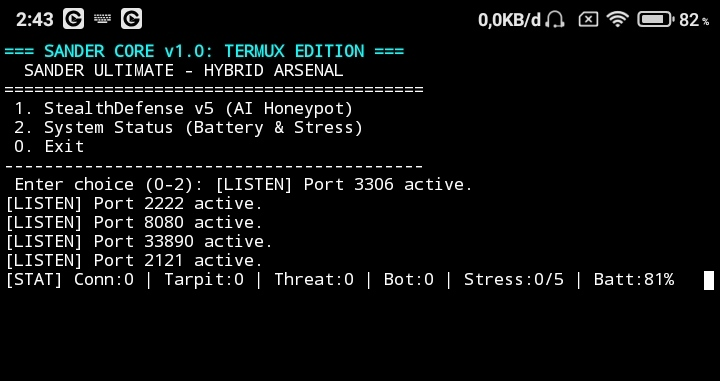
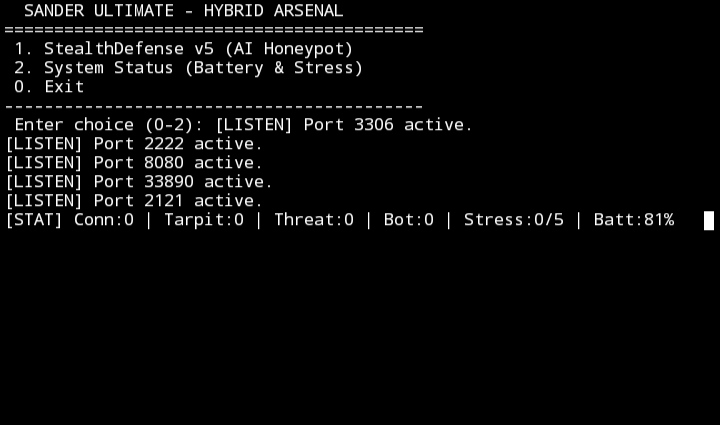
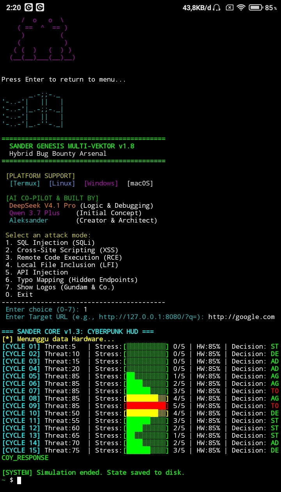

# ALEKSANDER — Offensive + Defensive Security ⚡️


[](https://github.com/aleksandergrambelik-png/SanderMultiVector/actions/workflows/audit.yml)
[](https://github.com/aleksandergrambelik-png/SanderSuite/actions/workflows/audit.yml)
[](https://github.com/aleksandergrambelik-png/SanderScan/actions/workflows/audit.yml)
[](https://github.com/aleksandergrambelik-png/StealthDefense/actions/workflows/audit.yml)

## Overview

I build compact, high-performance network utilities for reconnaissance, hardening, and defensive automation. My work focuses on practical security tooling that runs efficiently in constrained environments.

I often work from a phone, build in Java, and keep the tooling lean enough to be useful in real conditions. The goal is simple: fast signal, practical defense, and systems that remain useful under pressure.

## 🧪 Device Experiment

This is the actual mobile testbed used for building and stress-testing low-power security tools in real-world conditions.

```json
{
  "device": "Snapdragon 625",
  "cores": "8x A53 @ 2.0GHz (4+4 big.LITTLE)",
  "cache": "L1: 32KB I/D, L2: 512KB shared",
  "thermal_limit": "42°C throttle point",
  "env": "Termux non-root, Android 10, 3GB RAM",
  "tool_constraints": ["CLI-only", "no-GUI", "battery-aware", "termux-api-hw-access"]
}
```

Built for CLI-first engineering, battery-aware automation, and tooling that still performs well when the hardware is constrained.

## 📸 Project Gallery

Here are some screenshots from my recent projects:

### 1.


### 2.


### 3.


## DragonFly BSD — Architectural Inspiration (reference for my tools)

I often draw architectural inspiration from DragonFly BSD when designing SanderSuite, SanderScan, and StealthDefense. Below is a concise mapping of core DragonFly concepts to the corresponding design.

1. DragonFly BSD = Core Java (SanderSuite)
   - DragonFly acts as the "engine" that manages system resources. I mirror that role with a compact Core architecture and CLI in Java (ConfigManager, OutputManager). Minimal layers, maximum efficiency.

2. HAMMER2 = StealthDefense
   - HAMMER2 is known for resilience (snapshots, deduplication, crash tolerance). StealthDefense follows the same philosophy: resilient honeypot behavior with tarpit engagement, fake banners, and robust log capture.

3. HAMMER1 = SanderScan
   - HAMMER1 is the older, high-performance filesystem—fast and aggressive. SanderScan embraces that spirit with aggressive scanning mode, optimized for speed and direct results.

4. LWKT (Lightweight Kernel Threads) = Modular Task System
   - LWKT provides lightweight threading to run many tasks with low overhead. I apply that idea to a modular task system under com.sander.modules and a help/module system so features run as independent, efficient workers.

(Placed here so visitors can quickly understand the architectural philosophy that influenced SanderSuite, SanderScan, and StealthDefense.)


## 📸 Proof of Concept (Live Test)

Here is a real output from `stealth_log.csv` and `stealth_log.json` captured during a live test on a local network (Telkomsel Hotspot). The tool successfully detected a bot, engaged the tarpit, and logged the event.

### CSV Output (`stealth_log.csv`)

```csv
timestamp,event,ip,port,details
2026-10-18 21:17:39,CONN,10.52.***.***,8080,"New connection"
2026-10-18 21:17:39,BOT,10.52.***.***,8080,"Bot signature detected"
2026-10-18 21:17:39,TARPIT,10.52.***.***,8080,"Tarpit engaged"
2026-10-18 21:22:27,CONN,10.52.***.***,3306,"New connection"
2026-10-18 21:22:27,TARPIT,10.52.***.***,3306,"Tarpit engaged"
```

### JSON Output (stealth_log.json)

```json
[
  {"timestamp":"2026-10-18 21:17:39","event":"BOT","ip":"10.52.***.***","port":8080,"details":"Bot signature detected"},
  {"timestamp":"2026-10-18 21:17:39","event":"TARPIT","ip":"10.52.***.***","port":8080,"details":"Tarpit engaged"}
]
```

Note: IP addresses are partially redacted for privacy and ethical disclosure.

## What I do

- 🔭 I build powerful network utilities: scanners, recon suites, and lightweight defensive tools.
- 🌱 Learning: deepening my skills in network security and Java.
- 💬 Ask me about Termux, fast port scanning, or OSINT workflows.
- ⚡ Pro tip: I once scanned my own router — it ran a 2005 web server. I laughed, then patched it.

---

## Featured Projects — Ready to Run

### 🛡️ SanderMultiVector

> Hybrid Multi-Vector Bug Bounty Arsenal (Java + Perl + C++) for Termux/Linux.


**Features:**
- **6 Attack Modes:** SQLi, XSS, RCE, LFI, API Injection, Typo Mapping.
- **Hybrid Engine:** Java (Orchestrator) + Perl (Obfuscator) + C++ (Fast HTTP).
- **Double Output:** Real-time Terminal + JSONL Audit Log.
- **Interactive & CLI Mode:** Colored Menu + Command Line Support.
- **Cross-Platform:** Termux, Linux, Windows, macOS.
- **AI-Powered:** Built with Qwen 3.7 Plus & DeepSeek V4.1 Pro.

[→ View Repository](https://github.com/aleksandergrambelik-png/SanderMultiVector)

### SanderSuite — Beacon-Oriented Security Suite


A compact but ruthless security toolkit for beacon-driven intelligence, exposure mapping, and defensive action on Linux.

- Fast beaconing and service discovery
- Pseudo-AI risk triage for prioritizing exposed targets
- Exposure mapping under active threat pressure
- Banner and service fingerprinting
- Defensive hardening, lockdown guidance, and reporting
- Built for rapid decision-making in noisy, high-risk environments

SanderSuite is not just a recon tool. It behaves like a beacon engine: it emits signals, captures service intelligence, identifies exposed assets, and ranks the most dangerous targets before action is taken.

#### Core Features

##### 1. WAF Engine
Built-in payload filtering layer that blocks malicious requests before they reach the core logic.

- SQL Injection (SQLi)
  - UNION-based payloads
  - classic boolean bypasses
  - time-based injection patterns
- XSS
  - script tags
  - javascript: payloads
  - event handlers such as onerror=
- LFI
  - traversal attempts such as ../../etc/passwd
  - Windows path traversal patterns
- CMD Injection
  - command chaining via ;, |, &&, $()
- Sensitive Path Blocking
  - /.env
  - /.git/
  - /wp-config.php
  - /actuator
- Java Injection
  - Runtime.getRuntime()
  - ProcessBuilder
  - System.exit
- Nuclei Scanner Detection
  - common nuclei user-agent and request patterns

##### 2. Anti-Esoteric Language Filter
Catches payloads generated from unusual or obfuscated languages often seen in CTF and hostile scanning contexts.

- Brainfuck payload signatures
- JSFuck payload signatures
- obfuscated language markers such as fuck, kcuf, feck, and related variations

##### 3. Anti-Scan & Anti-Bot
Detection layer for noisy scanners and bot activity that behaves aggressively without normal application traffic.

- Anti-port scan tracking
  - repeated connection attempts across multiple ports from a single source
- Silent scan detection
  - scanners that probe without sending meaningful payloads
- Bot and abnormal behavior detection

##### 4. AI Threat Scoring
A lightweight scoring engine that turns activity into action.

- Monitor
  - score 1–29
  - logged and gently challenged
- Tarpit
  - score 30–69
  - delayed and throttled responses
- Block
  - score 70+
  - permanent blacklist trigger

[→ Explore SanderSuite](https://github.com/aleksandergrambelik-png/SanderSuite)

---

### SanderScan — LAN & Port Scanner (Phone-friendly)


Fast, threaded scanner built for Termux and PC. Made on a phone, optimized for speed.
- Auto network discovery
- 250-thread scanning mode
- Banner grabbing & MAC vendor lookup
- OS detection
- Export results to CSV/JSON

[→ Explore SanderScan](https://github.com/aleksandergrambelik-png/SanderScan)

---

### StealthDefense — Minimalist Honeypot & Tarpit


Honeypot + Anti-bot + Tarpit defense with built-in filters (Clickjacking, SQLi/XSS/LFI). Zero dependencies.

[→ Explore StealthDefense](https://github.com/aleksandergrambelik-png/StealthDefense)

---

## Philosophy

I prefer tools that work in the wild: compact, fast, and useful. If it warms my phone, it still gets the job done.

## GitHub Stats


---

## Tech & Tools


Made on a phone. Made to work. ⚙️

